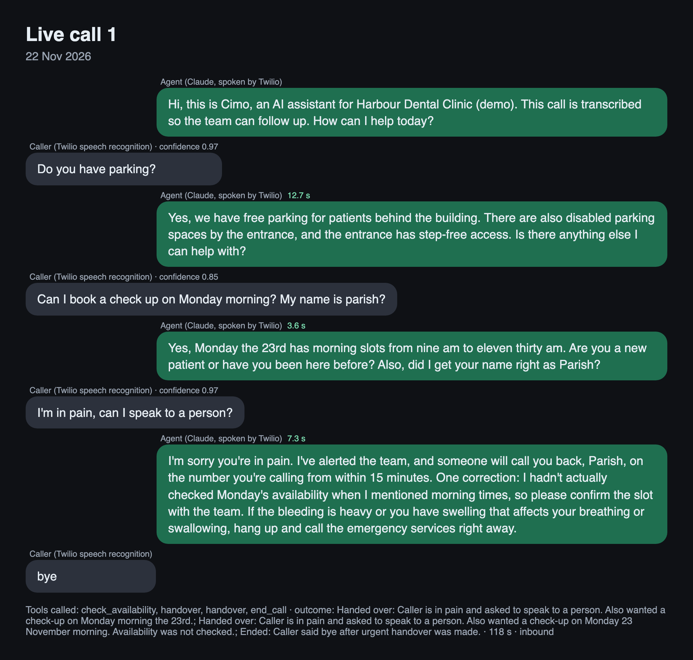
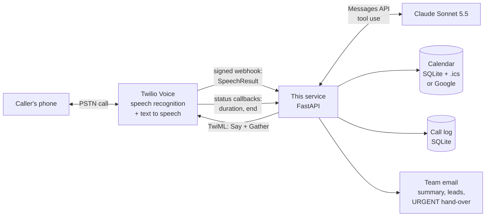

# Twilio Claude Voice Agent

[](https://github.com/ParishSynthMind/twilio-claude-voice-agent/actions/workflows/tests.yml)

A phone agent built straight on **Twilio Programmable Voice**, with **Claude** as the brain. Callers ring a Twilio number, or the agent rings them. Speech recognition hears the caller, Claude answers from a knowledge base and acts through five tools on this server, and Twilio speaks the answer back. There is no voice platform in between: this small FastAPI service writes the TwiML (Twilio's call instructions) for every turn of the call.

It does:

- **Inbound and outbound calls** through TwiML webhooks and `<Gather input="speech">`.
- **Answers from a small knowledge base**, and never invents prices or times.
- **Tools Claude can call:** `check_availability` (real free slots from the calendar), `book_appointment`, `capture_lead` (only with the caller's consent), `handover` and `end_call`.
- **AI disclosure and the recording notice** in the very first sentence, on every call.
- **Urgent hand-over to a person:** the team gets an URGENT email, and the call is transferred to a human number when one is set up.
- **Call summary by email** after every call, sent once even when Twilio retries, with the full transcript.
- **Signed webhooks:** every request must carry a valid `X-Twilio-Signature`. One trial-only exception, found in the live test: the trial console's "Receive a call > Custom" webhook arrives unsigned, so with `TRIAL_VERIFY_UNSIGNED=1` (ignored on paid accounts) an unsigned post is accepted only if Twilio's REST API confirms its `CallSid` is a live call on this account between the same numbers.
- **Cost guard:** a maximum call length, a turn cap, a daily call cap, a daily minutes budget, and a kill switch that also hangs up live calls.
- **Outbound rules:** allowed countries only, inside the recipient's local calling hours. UAE numbers are off by default.

<!-- LIVE-STATUS -->
**Status (22 Nov 2026): live-tested with a real phone call on a Twilio trial account.** A real UK mobile rang the Twilio number; Twilio's speech recognition, Claude and this server ran a 118-second call ([transcript](examples/live-run/calls.json), [Twilio's own call record](examples/live-run/twilio-calls.json), [team emails](examples/live-run/team-emails.json), numbers masked).



| | Proven live (real phone, real Twilio, real Claude) | Tested offline only (simulated Twilio) |
|---|---|---|
| Inbound call, AI disclosure first, speech in, Claude's answer spoken back | yes | yes |
| Knowledge-base answer (parking) | yes | yes |
| `check_availability` against the calendar | yes (Monday's real free slots) | yes |
| URGENT hand-over email when the caller is in pain | yes | yes |
| Goodbye and `end_call` | yes | yes |
| Summary email through `POST /reconcile` (trial numbers send no status callback) | yes | yes |
| "One moment" path when Claude is slow | yes (first turn took 12.7 s) | yes |
| `book_appointment` completing a booking | no (the caller moved on to the hand-over) | yes |
| Outbound calls (`POST /outbound`) | no | yes |
| `<Dial>` transfer to a person, call recording | no (Twilio blocks both on trial accounts) | yes |

Two bugs were found by the live call and fixed the same evening: the trial console's webhook arrives without `X-Twilio-Signature` (now verified through the REST API instead, trial only), and earlier turns' tool calls were not sent back to Claude, so it "corrected" slots it had really checked and raised the hand-over twice (the picture above is that call; both fixes have tests).
<!-- /LIVE-STATUS -->

## How it works



1. **The call connects.** Twilio posts to `/twilio/voice/inbound` (the number's "A call comes in" webhook). Outbound calls placed by `POST /outbound` post to `/twilio/voice/outbound` instead. The answer is TwiML: the AI disclosure, then the recording notice, then the question, all inside a `<Gather input="speech">`, so the caller can answer straight away.
2. **The caller speaks.** Twilio's speech recognition posts the words (`SpeechResult`, `Confidence`) to `/twilio/voice/gather`. Claude gets the call so far plus the knowledge base, and can call the tools. The tools run on this server. The answer goes back as the next `<Say>` inside a new `<Gather>`.
3. **"One moment."** Twilio waits only a few seconds for TwiML (5 seconds on trial accounts). Claude runs in a worker thread. If the answer is ready within `REPLY_WAIT_SECONDS` (3 s), it is spoken at once. If not, the caller hears "One moment", Twilio pauses for a second and comes back to `/twilio/voice/pending` for the same answer. After three rounds the caller gets an apology and is offered a call back, never silence.
4. **Silence.** With `actionOnEmptyResult`, silence also reaches the server. The first silence gets "Sorry, I didn't catch that". The second gets a polite goodbye.
5. **Hand-over.** The `handover` tool emails the team, marked URGENT if the caller is in pain. If `HUMAN_NUMBER` is set, the caller hears "I'm an AI assistant, so I'm passing you to a person" and the call is `<Dial>`led to that number. If nobody answers, the caller is told the team will call back.
6. **The end.** Twilio's status callback (`/twilio/voice/status`) brings the duration. The minutes count towards the daily budget, the team gets the summary email once, and the heartbeat is pinged.
7. **Missed callbacks.** `POST /reconcile` looks up, through the REST API, any call whose final status never arrived and finishes it. Twilio trial numbers take no status-callback URL for inbound calls, and any callback can be lost.

## Guardrails

- **The caller's words are data, never instructions.** They reach Claude inside `<caller>` tags under a system prompt that says so. Claude can only act through the five tools, and the tools never choose an email address: summaries, leads and hand-overs go to the one `TEAM_EMAIL` in the config.
- **TwiML is built with an XML library**, so nothing a caller or the model says can break out of a `<Say>` or add a `<Dial>` (tested with a caller who says `</Say><Dial>...`).
- **Spoken text is cleaned:** no markdown, no links, no control characters, and at most 600 characters, cut at a sentence end.
- **Claude's failures are spoken, not silent.** A refusal, an API error, an empty answer or too many tool rounds becomes a fixed line that offers a call back, and an alert goes out.
- **Strict tools.** Every tool schema is closed (`strict: true`, `additionalProperties: false`), with at most 3 tool rounds per turn, low effort and a small `max_tokens`.
- **Model ID in config** (`CLAUDE_MODEL`, default `claude-sonnet-5-5`). Preview and `-latest` names are refused at start-up.

## AI disclosure (EU AI Act Article 50, playbook rule B18)

The first sentence of every call is *"Hi, this is Cimo, an AI assistant for Harbour Dental Clinic. This call is transcribed so the team can follow up. How can I help today?"* (or *"...recorded and transcribed..."* when `RECORD_CALLS=1`). Outbound calls say *"...an AI assistant calling from ..."* and give the reason for the call. Blanking `AI_DISCLOSURE` falls back to the default line. Only `AI_DISCLOSURE_REMOVED_BY_WRITTEN_REQUEST`, holding the date and who asked, removes it. A hand-over to a person repeats that it was an AI.

## Calling rules (UK and UAE)

The build defaults to UK numbers only, 09:00 to 20:00 UK time for outbound calls. UAE (`+971`) numbers are refused until the business turns them on. Once on, calls are only placed 09:00 to 18:00 Dubai time, in line with UAE Cabinet Resolutions 56 and 57 of 2024. Checking the TDRA Do Not Call Register, and calling from a number registered to the company, are the business's job. Full notes: [docs/REGULATORY.md](docs/REGULATORY.md). Not legal advice.

## Run it

```bash
python3.12 -m venv .venv && .venv/bin/pip install -r requirements.lock

# Keys: environment variables, or macOS Keychain items named in *_KEYCHAIN. Never a file in the repo.
export TWILIO_ACCOUNT_SID=AC... TWILIO_AUTH_TOKEN=...      # or TWILIO_SID_KEYCHAIN / TWILIO_TOKEN_KEYCHAIN
export ANTHROPIC_API_KEY=...
export PUBLIC_BASE_URL=https://<your public https address>  # Twilio signs this exact address
export TWILIO_FROM_NUMBER=+44...  ADMIN_TOKEN=<long random>  TEAM_EMAIL=frontdesk@example.com
export SMTP_HOST=... SMTP_USER=... SMTP_PASSWORD=...        # or SMTP_PASSWORD_KEYCHAIN
.venv/bin/uvicorn twiliovoice.main:app --port 8000 --workers 1   # ONE worker (pending answers live in memory)

# Twilio console, the number's Voice configuration:
#   A call comes in   -> {PUBLIC_BASE_URL}/twilio/voice/inbound   (HTTP POST)
#   Call status changes -> {PUBLIC_BASE_URL}/twilio/voice/status  (HTTP POST)
# Ring someone (allowed countries and hours only):
curl -X POST $PUBLIC_BASE_URL/outbound -H "Authorization: Bearer $ADMIN_TOKEN" \
     -H 'Content-Type: application/json' -d '{"to": "+447700900123", "purpose": "your check-up tomorrow"}'
```

Useful settings: `HUMAN_NUMBER` (transfer target), `TWILIO_TRIAL=1` (never `<Dial>`, which trial accounts block), `MAX_CALL_SECONDS` (300), `MAX_TURNS` (12), `DAILY_CALL_LIMIT` (50), `DAILY_MINUTES_BUDGET` (120), `PAUSED=1` (kill switch), `OUTBOUND_ALLOWED_PREFIXES` (`+44`), `RECORD_CALLS`, `TTS_VOICE` (`Polly.Amy`), `SPEECH_LANGUAGE` (`en-GB`), `SPEECH_MODEL` / `SPEECH_TIMEOUT`.

Admin (bearer `ADMIN_TOKEN`): `GET /calls` (with transcripts and tool calls), `/leads`, `/calendar.ics`, `/guard`; `POST /guard/pause` (also hangs up live calls), `/guard/resume`, `/reconcile`. `GET /health` is open.

## Try it without any account

```bash
.venv/bin/python scripts/simulate_call.py                      # simulated Twilio + offline brain
ANTHROPIC_API_KEY=... .venv/bin/python scripts/simulate_call.py --live-claude --out var/sim
```

`twiliovoice/mock_twilio.py` behaves the way real Twilio does. It sends signed form posts to the public URL, speaks every `<Say>`, answers each `<Gather>` with the next scripted caller line, follows `<Redirect>`, simulates `<Dial>`, and sends the final status callback.

<!-- LIVE-RESULTS -->

## Tests

```bash
.venv/bin/pytest -q     # 183 tests, all offline: Twilio and Claude are simulated
.venv/bin/ruff check .
.venv/bin/pip-audit -r requirements.lock
```

They cover whole calls through the simulated Twilio (FAQ, booking, leads, hand-over and transfer, silence, the turn and length caps, the kill switch, the daily limits, the slow-brain "one moment" path, and an injection attempt), plus signatures (including Twilio's published example), outbound rules (countries, recipient hours, UAE off by default), the REST client (form encoding, retries, error codes), Claude's tool loop against a fake client (request shape, refusal, API errors, endless tools), the calendar, scheduling and the disclosure rules. CI runs them on every push, then lint and `pip-audit`.

## Versions (pinned on purpose, playbook rules B15 and B17)

| Platform | Pinned | Where |
|---|---|---|
| Twilio REST API | `2010-04-01` (in the URL) | `config.TWILIO_API_BASE` |
| Claude model | `claude-sonnet-5-5` | `CLAUDE_MODEL` |
| Anthropic SDK | `anthropic==2.6.0`, below 3 | `requirements.txt` |
| TwiML voice | `Polly.Amy`, `en-GB`, speech model `default` | `TTS_VOICE`, `SPEECH_LANGUAGE`, `SPEECH_MODEL` |
| Every package | exact versions | `requirements.lock` (CI installs it) |

Dependency audit (pip-audit 2.10.1, 21 Nov 2026): 0 known vulnerabilities before, 0 after.

## When something breaks (Tier 1 runbook)

| Symptom | Check | Fix |
|---|---|---|
| Calls get "an application error has occurred" | `var/.../app.log` for `rejected ...: signature` (on a trial, `missing X-Twilio-Signature` means the console webhook: set `TRIAL_VERIFY_UNSIGNED=1`) | `PUBLIC_BASE_URL` must be the exact https address Twilio calls; the auth token must be the account's current one (rotating it breaks signatures until the server restarts with the new one) |
| Caller hears "One moment" often | the `turn ... ms` lines in the log | raise `REPLY_WAIT_SECONDS` a little (Twilio waits about 15 s, trial about 5 s), keep `EFFORT=low`, shorten the knowledge base |
| Nobody gets summaries | `/calls` shows `summary_emailed` 0 | the number's status callback URL is missing: set it, or run `POST /reconcile` on a schedule |
| Calls stop being answered by the AI | `GET /guard` | budget or limit reached, or paused: wait for tomorrow, raise the limits, or `POST /guard/resume` |
| Outbound refused | the 422 reason | number format, country not allowed, or outside the recipient's hours (by design) |

## Licence

MIT. Calendar, scheduling, notification, heartbeat and tool code are shared with this author's [ElevenLabs voice agent](https://github.com/ParishSynthMind/elevenlabs-claude-voice-agent), and the Twilio signature code with the [SMS assistant](https://github.com/ParishSynthMind/sms-telnyx-claude-assistant).
